# Regenerative system — documentation

`mint` is a local, Codeplain-inspired **regenerative coding system**. You write
specs (`*.mint.md`); `mint` renders them into working, tested code, one functional
unit at a time, and re-renders only the slices affected when a spec or a dependency
changes.

This directory documents the system as built. It supersedes `docs/regenerative-mvp/`
(kept for history). For the repo landing page and quickstart, see
[`../../README.md`](../../README.md). This page walks the mechanism in the order it
runs; each section links to the document that covers it in depth.

## 1. The spec is Markdown with a contract

One file per module, `<module>.mint.md`, under `.mint/specs/`. YAML frontmatter
picks the stack and the renderer. Four `##` sections are mandatory:
`definitions`, `implementation`, `test`, and `functional`. The functional section
is a list of units (`FR1`, `FR2`, ...) with a title, spec bullets, and acceptance
bullets. Ids are unique and strictly ascending, because the order is the render
order.

Every part of the spec is hashed, and which hash a part feeds decides the blast
radius of editing it:

<picture>
  <source media="(prefers-color-scheme: dark)" srcset="figures/spec-hashes-dark.svg">
  
</picture>

`mint lint <module>` rejects specs that will render badly: vague terms, acceptance
bullets with no testable assertion, thresholds without a stated boundary.

Read: [spec-format.md](spec-format.md), [`../spec-authoring.md`](../spec-authoring.md).

## 2. Every unit goes through the same loop

For each unit in the render plan, `mint` builds a prompt from the spec, the
imported vocabulary, the required modules' public interface, and everything
rendered so far. The renderer answers with a file patch. `mint` applies it and runs
the gates in order, cheapest first. A failed gate feeds its output back into the
prompt for exactly one retry; a second failure fails the render.

<picture>
  <source media="(prefers-color-scheme: dark)" srcset="figures/render-loop-dark.svg">
  
</picture>

- **Style lock** (only if the spec declares it) scans generated `src/` before any
  test runs, so a violation never costs a test run.
- **Unit gate** runs the tests the renderer wrote for its own code.
- **Conformance gate** runs the tests derived from acceptance, plus every prior
  unit's conformance tests as regression.
- **Test-quality gate** is covered in section 6.
- **Checkpoint** lands the unit as two commits (code, then metadata) in the
  module's nested git repo under `.mint/generated/<module>/`.

Read: [architecture.md](architecture.md), [metadata-and-checkpoints.md](metadata-and-checkpoints.md),
[cost-and-budgets.md](cost-and-budgets.md).

## 3. Renderers emit a patch, never a write

Deterministic templates and language models produce the same artifact: a JSON
list of file operations with `path`, `action` (`write` or `delete`), `root`
(`module` or `conformance`), and `contents`. Validation rejects absolute paths,
`..` segments, the module root itself, and reserved first components such as
`.git` and `.mintgen`. Applying is two-pass: every target is resolved and
checked for containment before anything is written, so a bad patch leaves the
tree untouched. Malformed or oversized responses are classified `patch_invalid`
and fed back like a failing test.

Read: [renderer-contract.md](renderer-contract.md).

## 4. Only the changed slice is re-rendered

`mint render` with nothing changed is a no-op. With a changed unit, the planner
compares stored hashes in `.mintgen/module.json` against the current spec and
returns a unit range; the generated repo is reset to the commit before that
range, the conformance tests for those units are dropped, and rendering resumes
from there. A required module whose public interface changed rebuilds its
dependents from `FR1`.

<picture>
  <source media="(prefers-color-scheme: dark)" srcset="figures/incremental-render-dark.svg">
  
</picture>

Multi-module renders resolve `requires` into a topological order and run the
loop per module, required modules first. Only the named module honours `--from`,
`--range`, and `--force`.

Read: [module-graph.md](module-graph.md), [building-an-app.md](building-an-app.md).

## 5. Models are recorded once and replayed

A live model call is not reproducible, so `mint` never makes one by default.
Every model response is a cassette under `resources/cassettes/v1/`, keyed by a
hash of the prompt version, module, unit, phase, attempt, model id, and the full
prompt text. Ordinary renders replay; recording happens only behind
`MINT_LIVE=1`, and CI never sets it. A missing or stale cassette is a hard error
with a re-record hint, never a silent fallback.

<picture>
  <source media="(prefers-color-scheme: dark)" srcset="figures/record-replay-dark.svg">
  
</picture>

CLI providers run in an empty scratch directory, never the project, so the only
way model output reaches disk is through the validated patch.

Read: [record-replay.md](record-replay.md), [release-and-ci.md](release-and-ci.md).

## 6. Tests have to prove they can fail

A model asked to write code and tests together will write tests that pass by
construction. The test-quality gate runs after unit and conformance pass (deferred
to the final unit for multi-unit modules) and requires a coverage floor,
acceptance traceability (every acceptance bullet maps to a conformance test), and
a coverage-guided mutation probe.

<picture>
  <source media="(prefers-color-scheme: dark)" srcset="figures/mutation-probe-dark.svg">
  
</picture>

Read: [test-quality.md](test-quality.md), [typescript.md](typescript.md).

## 7. Mint renders parts of mint

Two components are self-hosted and checked for parity against their handwritten
originals on every test run: `mint-hashing` (a hand-authored replay cassette)
and `mint-patch`, the patch contract from section 3, rendered live by
`claude-fable-5-1` through the `claude-cli` provider.

<picture>
  <source media="(prefers-color-scheme: dark)" srcset="figures/self-hosting-parity-dark.svg">
  
</picture>

The experiment also found an acceptance gap: a second live render passed every
gate but handled delete containment differently, because that rule lived only in
`## implementation`. It is now pinned in `FR3` acceptance. Anything a consumer
relies on belongs in acceptance, because that is the only part of the spec a gate
can enforce.

Read: [commands.md](commands.md) (self-hosting proof section),
[known-limits.md](known-limits.md) (risk 1).

## 8. What it does not do yet

One retry per phase, hash-based change detection, manual live recording,
Python-only app composition, run-everything conformance regression, single
writer per module graph.

Read: [known-limits.md](known-limits.md).

## Reference

| Doc | What it covers |
| --- | --- |
| [architecture.md](architecture.md) | Components, the render loop, data flow |
| [renderer-contract.md](renderer-contract.md) | The file-patch contract and adapter interface |
| [record-replay.md](record-replay.md) | Model cassette format, replay defaults, live re-record flow |
| [test-quality.md](test-quality.md) | Coverage, acceptance-traceability, and mutation anti-weak-test gates |
| [cost-and-budgets.md](cost-and-budgets.md) | Attempt and token budgets, abort reports, cost estimate limits |
| [release-and-ci.md](release-and-ci.md) | Package metadata, offline CI, manual live-record workflow |
| [spec-format.md](spec-format.md) | `*.mint.md` structure and validation rules |
| [typescript.md](typescript.md) | Supported TypeScript stacks, package scripts, and current limits |
| [module-graph.md](module-graph.md) | `imports`, `requires`, ordering, cascades |
| [metadata-and-checkpoints.md](metadata-and-checkpoints.md) | `.mintgen/module.json`, attempts, git checkpoints |
| [commands.md](commands.md) | Every CLI command with examples |
| [building-an-app.md](building-an-app.md) | From a module graph to a running app: `render --all`, `env`, `run`, `exec` |
| [known-limits.md](known-limits.md) | What it does not do yet, and the next risks |

The figures under `figures/` are the same drawings in light and dark variants;
each `<picture>` above picks one by the viewer's colour scheme.

## 60-second tour

```bash
# In a fresh directory, create the Mint project skeleton.
mint init --write
mint doctor
mint render example

# Render a module and everything it requires, in dependency order.
mint render tasklist

# Nothing changed → no-op.
mint render tasklist

# Edit a later unit in .mint/specs/tasklist.mint.md, then:
mint render tasklist        # re-renders only from the changed unit

# Edit .mint/specs/taskstore.mint.md (a required module), then:
mint render tasklist        # re-renders taskstore, then tasklist (its code dep moved)

# Render every spec in the project, then run the result as an app.
mint render --all
mint run tasklist --entry tasklist.cli -- add "write the spec"

# Replayed model path, no templates:
mint render calc-cli        # renders lexer -> parser -> evaluator -> calc-cli
mint render mint-hashing    # renders a mint hashing component via replay
mint render mint-patch      # renders mint's own patch contract, recorded by claude-fable-5-1

# New arbitrary specs opt into the model renderer:
mint new notes --renderer claude-cli --model sonnet --prompt-version notes-v1
MINT_LIVE=1 mint live-smoke notes

# New TypeScript library specs use the same model/replay path:
CODEX_MODEL=your-codex-model-id
mint new calc-ts --stack typescript-lib --renderer codex-cli \
  --model "$CODEX_MODEL" --prompt-version calc-ts-v1
```

Ordinary renders run offline. The default renderer is deterministic; the
model-backed renderer replays local cassettes by default and records live responses
only behind `MINT_LIVE=1`. The replay fixtures include both the calculator graph
and two self-hosted components checked for parity with their handwritten
originals: `mint-hashing` against `mint_cli.hashing` and `mint-patch` against
`mint_cli.renderer.patch`.

## Current Gates

Offline CI installs `.[dev]`, runs `mint doctor`, and runs pytest with an 80%
coverage floor. The default suite includes `tests/e2e/`, which drives `mint` through
subprocesses against isolated project directories.

Python generated-code unit, conformance, and test-quality checks run through
`PYTHON_BIN`. TypeScript modules use the stack adapter to run Node/npm package
scripts: `tsc --noEmit`, Vitest unit tests, and Vitest conformance tests. TypeScript
test-quality runs too — Vitest v8 coverage, acceptance traceability, and a
TypeScript-compiler-API mutation probe — and hard-fails when the required dev tooling
(`@vitest/coverage-v8`, `typescript`) is not installed.
